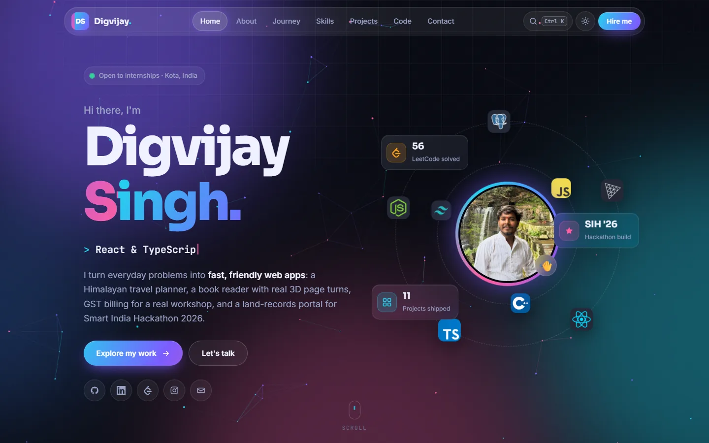
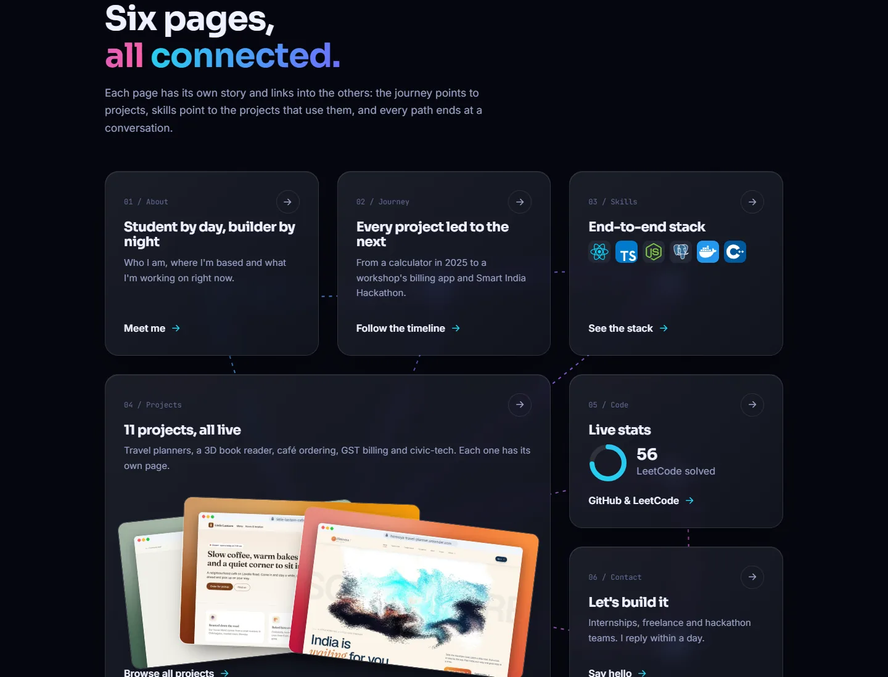
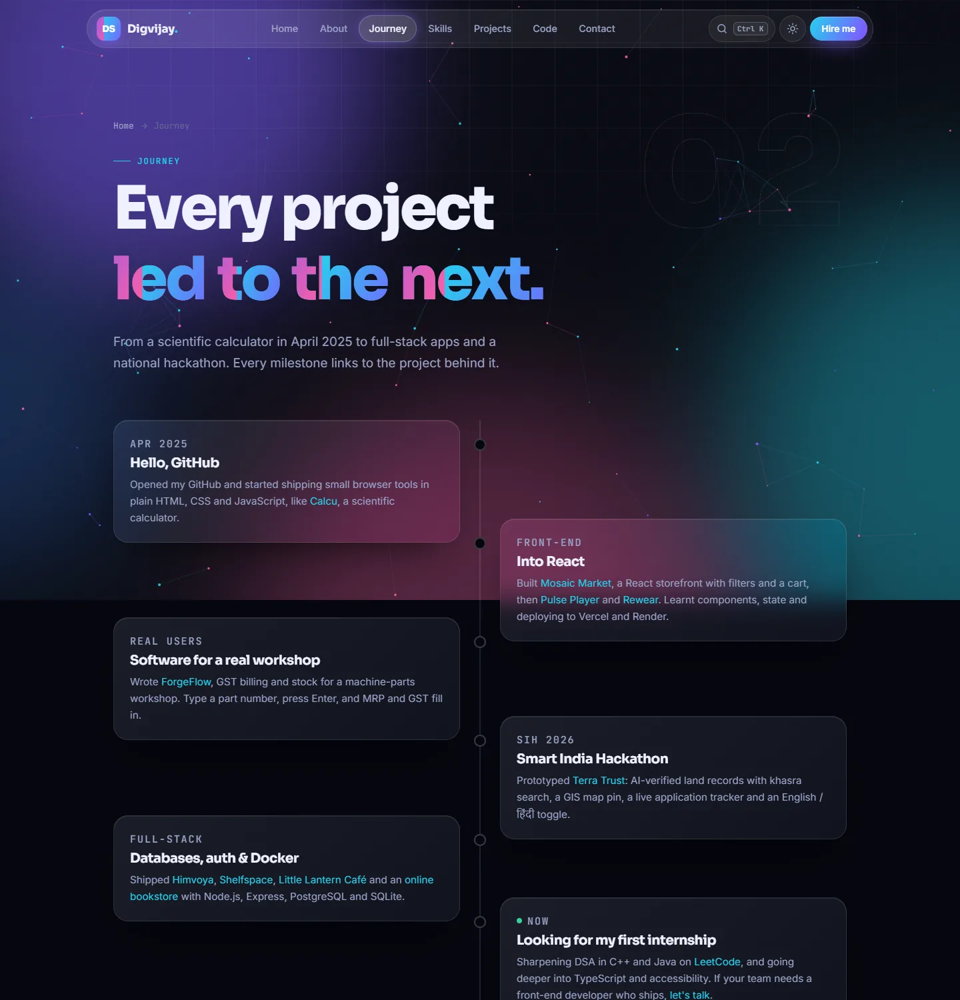
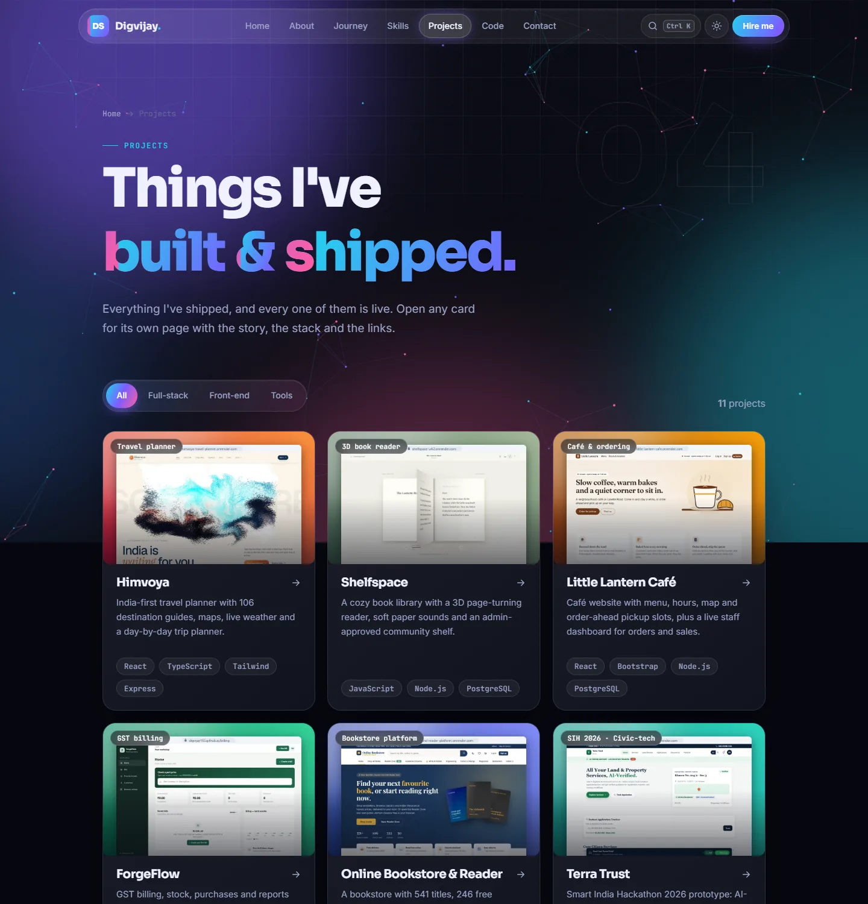
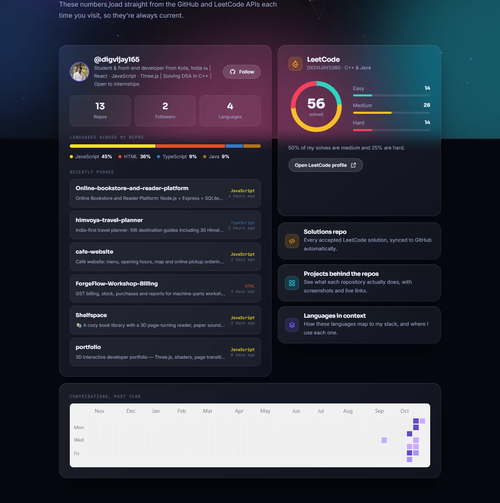

<div align="center">

# ✨ Digvijay Singh — Developer Portfolio

### *Front-End Developer · Kota, India · React · TypeScript · Node.js*

A multi-page portfolio where every page links into the others. Built with **glassmorphism**, **cross-page view transitions**, **custom web components** and **live GitHub + LeetCode data**, in plain HTML, CSS and JavaScript. No framework, no build step.

[](https://digvijay165.github.io/portfolio/)


**[🌐 Live Site](https://digvijay165.github.io/portfolio/)** · **[💼 LinkedIn](https://www.linkedin.com/in/digvijay-singh-a188b1382/)** · **[🧠 LeetCode](https://leetcode.com/u/DIGVIJAY5360/)** · **[✉️ Email](mailto:digvijaysingh5360@gmail.com)**

<br>

<a href="https://digvijay165.github.io/portfolio/">
  
</a>

</div>

---

## 🗺️ Pages

Each topic has its own page. A glass nav, previous / next bridges, a command menu and dozens of cross-links tie them together.

| # | Page | What's on it | Links out to |
| :---: | --- | --- | --- |
| 00 | 🏠 **[Home](https://digvijay165.github.io/portfolio/)** | Hero, orbiting stack, and a map of every page with animated connection lines | Every page |
| 01 | 👤 **[About](https://digvijay165.github.io/portfolio/about.html)** | Bio, live Kota clock, what I'm building now, stats | Projects, Journey, Code |
| 02 | 🧭 **[Journey](https://digvijay165.github.io/portfolio/journey.html)** | Scroll-drawn timeline from April 2025 to today | The project behind each milestone |
| 03 | 🛠️ **[Skills](https://digvijay165.github.io/portfolio/skills.html)** | Stack grouped by layer, each tool with a project count | Projects filtered by that tool |
| 04 | 🚀 **[Projects](https://digvijay165.github.io/portfolio/projects.html)** | Filterable grid of every project | A detail page per project |
| ↳ | 📄 **Project page** | Screenshot, highlights, stack, live + code links, related work | Tech filters, previous / next project |
| 05 | 📊 **[Code](https://digvijay165.github.io/portfolio/code.html)** | Live GitHub repos, language split, LeetCode difficulty ring | Project pages for each repo |
| 06 | 💬 **[Contact](https://digvijay165.github.io/portfolio/contact.html)** | Glass form that opens your email app, copy-email, socials, FAQ | Projects, Skills, Code |

<table>
  <tr>
    <td width="50%"></td>
    <td width="50%"></td>
  </tr>
  <tr>
    <td width="50%"></td>
    <td width="50%"></td>
  </tr>
</table>

---

## ✨ Highlights

| | Feature | How it works |
| :---: | --- | --- |
| 🪟 | **Glassmorphism** | Frosted cards with `backdrop-filter`, layered gradients, a cursor-following spotlight and glowing borders |
| 🔀 | **Page transitions** | Cross-document View Transitions: the header stays put, titles morph, and project screenshots grow into their detail page. A fade fallback covers other browsers |
| 🧩 | **Custom components** | `<site-header>`, `<site-footer>`, `<page-bridge>`, `<command-palette>` and `<site-bg>` web components keep every page in sync |
| ⌨️ | **Command menu** | Press <kbd>Ctrl</kbd> <kbd>K</kbd> (or <kbd>/</kbd>) to jump to any page, project or link |
| 🌌 | **Living background** | Drifting aurora blobs, a grid, film grain and a particle network that reaches toward your cursor |
| 🎬 | **Animations** | Letter-by-letter headline reveals, text scramble, typewriter roles, blur-up scroll reveals, counters, orbiting icons, tilt cards, magnetic buttons, ripples and a sliding nav pill |
| 📡 | **Live data** | GitHub REST API for repos and languages, LeetCode stats for the difficulty ring, cached per session with offline fallbacks |
| 🌗 | **Light & dark** | Theme switch with a circular reveal, remembered between visits |
| 📱 | **Responsive & accessible** | Phone-first menu, keyboard navigation, skip link, `prefers-reduced-motion` support |

---

## 📁 Project Structure

```
portfolio/
├── index.html          # Home: hero + page map
├── about.html          # About
├── journey.html        # Timeline
├── skills.html         # Stack, linked to projects
├── projects.html       # Filterable project grid
├── project.html        # Project detail (project.html?p=<slug>)
├── code.html           # Live GitHub + LeetCode
├── contact.html        # Contact form, socials, FAQ
├── 404.html            # Self-contained not-found page
├── css/style.css       # Design tokens, glass system, animations
├── js/
│   ├── data.js         # ✏️ Pages, links and projects: edit this to update the site
│   ├── components.js   # Shared web components
│   └── main.js         # Interactions, transitions, live data
├── assets/
│   ├── icons.svg       # SVG icon sprite
│   ├── projects/       # Project screenshots
│   └── favicon.svg
└── docs/               # README screenshots
```

---

## 🚀 Run Locally

Serve the folder over HTTP (the icon sprite and API calls need it):

```bash
git clone https://github.com/digvijay165/portfolio.git
cd portfolio
npx serve .
```

Or with Python: `python -m http.server 8000`, then open `http://localhost:8000`.

---

## 🎨 Make It Yours

| Want to change… | Edit this |
| --- | --- |
| ✏️ Projects, links, page order | `js/data.js` |
| 🎨 Colours, radius, fonts | Tokens at the top of `css/style.css` (`--a1`, `--a2`, `--a3`, …) |
| 🧭 Timeline | `journey.html` |
| 👤 GitHub / LeetCode user | `github` and `leetcode` in `js/data.js` |

Adding a project to `js/data.js` automatically adds its card, its detail page, its command-menu entry, and its count on the Skills page.

---

## 🌐 Deployment

Hosted on **GitHub Pages** from `main` / root. Every push redeploys. Also works as-is on Vercel or Netlify.

---

## 📬 Let's Connect

I'm **open to internships, freelance work and hackathon teams**.

[](mailto:digvijaysingh5360@gmail.com)
[](https://www.linkedin.com/in/digvijay-singh-a188b1382/)
[](https://leetcode.com/u/DIGVIJAY5360/)
[](https://www.instagram.com/digvijay.singh_)
[](https://github.com/digvijay165)

---

## 📄 License

Released under the **MIT License**. See [`LICENSE`](./LICENSE).

<div align="center">

⭐ **If you like this portfolio, give it a star!** ⭐

Designed & built from scratch by [Digvijay Singh](https://github.com/digvijay165)

</div>
