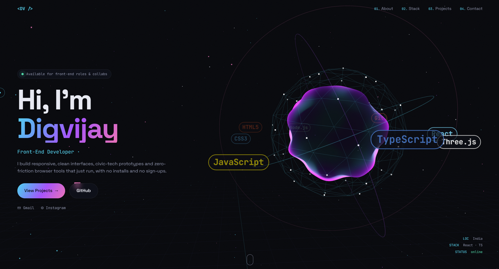

<div align="center">

# 🌌 3D Developer Portfolio

### *Front-end developer · React · TypeScript · Three.js*

An immersive, interactive portfolio built with **Three.js**, custom **GLSL shaders**, and cinematic page transitions, all with zero build steps.

[](https://digvijay165.github.io/portfolio/)


**[🌐 Live Site](https://digvijay165.github.io/portfolio/)** · **[👋 Say Hello](https://github.com/digvijay165/portfolio/issues/new/choose)** · **[🐛 Report Bug](https://github.com/digvijay165/portfolio/issues)**

<br>

<a href="https://digvijay165.github.io/portfolio/">
  
</a>

</div>

---

## 📖 About

This is my personal developer portfolio: a single-page experience where a **live 3D scene** reacts to your mouse and scroll, sections transition with a **curtain wipe and warp-speed star streak**, and my latest GitHub projects load **live from the GitHub API**.

It's built with plain HTML, CSS, and JavaScript, with Three.js loaded through an import map, so there's **no `npm install` and no build step**.

> 🔗 **Visit:** [digvijay165.github.io/portfolio](https://digvijay165.github.io/portfolio/)

---

## ✨ Features

| | Feature | Description |
| :---: | --- | --- |
| 🧊 | **3D tech core** | A morphing icosahedron with a custom GLSL simplex-noise shader, wireframe shell, orbit rings, and my tech stack orbiting as 3D labels |
| 🌠 | **Particle starfield** | 2,600 coloured particles and a scrolling neon grid that react to the mouse and scroll |
| 🎬 | **Page transitions** | Staggered 5-panel curtain wipe, warp-speed star streak, and FOV punch in the 3D scene |
| ⏳ | **Preloader** | Boot-sequence counter that wipes away to reveal the site |
| 🔤 | **Text effects** | Scramble/decode name, typewriter roles, and an animated terminal "about" card |
| 🃏 | **3D tilt cards** | Perspective tilt and cursor-following spotlight on skill and project cards |
| 🧲 | **Micro-interactions** | Custom cursor, magnetic buttons, blur scroll-reveals, animated skill meters, outlined marquee |
| 📡 | **Live GitHub feed** | Latest public repos from the GitHub API, with an offline fallback |
| 📱 | **Responsive & accessible** | Mobile circle-reveal menu, `prefers-reduced-motion` support, semantic HTML |
| 🔍 | **SEO-ready** | `sitemap.xml`, `robots.txt`, and a custom `404.html` page |

---

## 🗺️ Site Sections

| Section | What's inside |
| --- | --- |
| 🏠 **Home** | Hero with the 3D core, scrambled name, and typewriter roles |
| 👤 **About** | Animated terminal-style intro card |
| 🛠️ **Skills** | Tilt cards with animated skill meters |
| 🚀 **Projects** | Featured work plus a live GitHub repo feed |
| 📬 **Contact** | Email, social links, and a "say hello" option |

---

## 🛠️ Tech Stack

- **HTML5**: semantic page structure
- **CSS3**: custom properties, keyframe animations, and transitions
- **Vanilla JavaScript (ES Modules)**: interactions, loader, and GitHub feed
- **Three.js r160**: 3D scene, loaded from CDN with an import map
- **GLSL**: custom simplex-noise vertex and fragment shaders
- **GitHub REST API**: live repository feed
- **GitHub Pages**: hosting with automatic deploys

---

## 📁 Project Structure

```
portfolio/
├── index.html                   # Page markup
├── 404.html                     # Custom not-found page
├── css/
│   └── style.css                # Styles, animations, transitions
├── js/
│   ├── main.js                  # Loader, transitions, reveals, cursor, tilt, GitHub feed
│   └── scene.js                 # Three.js 3D scene (ES module)
├── assets/
│   └── favicon.svg
├── .github/ISSUE_TEMPLATE/      # "Say hello" contact template
├── robots.txt · sitemap.xml · .nojekyll
├── portfolio-screenshot.png     # README preview image
└── LICENSE
```

---

## 🚀 Getting Started

ES modules need an HTTP server, so opening `index.html` directly (`file://`) won't work.

```bash
git clone https://github.com/digvijay165/portfolio.git
cd portfolio
npx serve .
```

Or with Python:

```bash
python -m http.server 8000
```

Then open `http://localhost:8000`, or the port shown.

---

## 🎨 Customise

| What | Where |
| --- | --- |
| ✏️ Text and projects | `index.html` |
| 🎨 Colours | CSS variables at the top of `css/style.css` (`--accent`, `--accent-2`, …) |
| 🏷️ 3D orbiting labels | The `stack` array in `js/scene.js` |
| 👤 GitHub feed user | `GITHUB_USER` in `js/main.js` |

---

## 🌐 Deployment

Deployed on **GitHub Pages**, and every push to `main` redeploys automatically.

| Setting | Value |
| --- | --- |
| Live URL | [digvijay165.github.io/portfolio](https://digvijay165.github.io/portfolio/) |
| Source | **Settings → Pages →** *Deploy from a branch* → `main` / `(root)` |
| Build command | *None* |

> 💡 It also works on **Vercel** or **Netlify** as a static site, with no configuration.

---

## 📬 Contact

[](mailto:digvijaysingh5360@gmail.com)
[](https://instagram.com/digvijay.singh_)
[](https://github.com/digvijay165)

Or open an [issue](https://github.com/digvijay165/portfolio/issues/new/choose) to say hello 👋

---

## 📄 License

This project is licensed under the **MIT License**. See [`LICENSE`](./LICENSE) for details.

---

<div align="center">

⭐ **If you like this portfolio, give it a star!** ⭐

Made with ☕, WebGL, and way too many keyframes by [Digvijay Singh](https://github.com/digvijay165)

</div>
